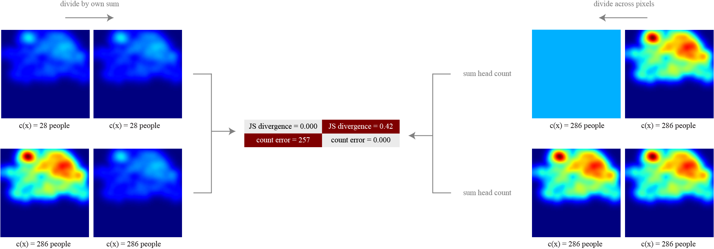

# Crowds Are Mass

**Rethinking Evaluation for Crowd Density Forecasting**  
Khalid AlAmoudi and Alala Bahamid



*A crowd forecast must predict both how many people and where.*

Research code for evaluating crowd density forecasts with unbalanced optimal
transport, keeping headcount and placement in the same comparison.

[Paper](paper.tex) · [GCS results](results/tables/gcs.md) · [Indoor results](results/tables/indoor.md) · [Reproducibility](docs/REPRODUCIBILITY.md)

## Reproduce the tables

```sh
python -m pip install -r requirements-results.txt
python scripts/reproduce_tables.py
```

Runs on CPU using the bundled per-clip predictions and saved metrics.
Writes Markdown, CSV, and JSON tables to `results/tables/`.

## Train and evaluate

Prepare the [annotation data](docs/DATA.md), then install the training dependencies:

```sh
python -m pip install -r requirements.txt
python scripts/train.py --dataset gcs
python scripts/train.py --dataset indoor --epochs 40
python scripts/evaluate.py --ckpt runs/YOUR_FINAL_CHECKPOINT.pt --dataset gcs
```

Defaults match the recorded GCS settings: 8 observed frames, 12 forecast frames,
and 20 training epochs. See [run configurations](configs/) and
[reproducibility details](docs/REPRODUCIBILITY.md) for the full protocol.

## Tests

```sh
python -m pip install -r requirements-dev.txt
python -m pytest -q
```

[Citation](CITATION.cff) · [Licensing](LICENSE.md) · [Third-party attribution](THIRD_PARTY_NOTICES.md) · [Release notes](docs/RELEASE.md)
